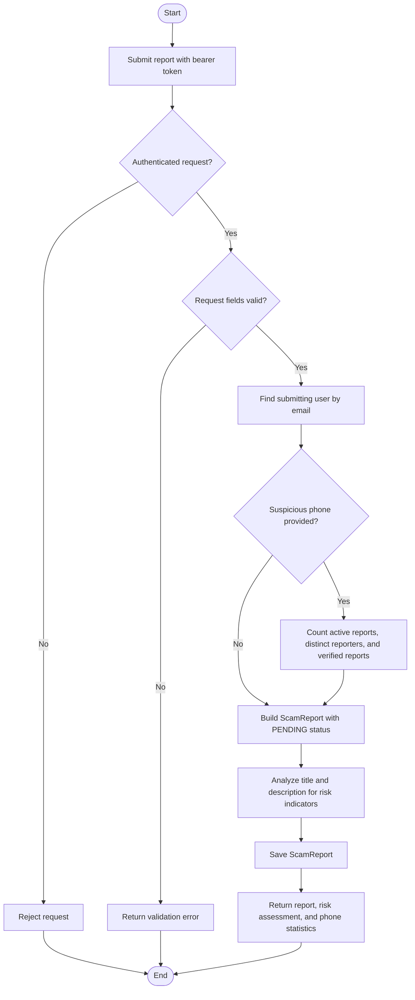

# Scam report submission activity diagram

This activity follows `POST /api/reports`. The optional phone-statistics lookup occurs before risk analysis and saving.

If authentication is absent or invalid, the stateless security filter chain does not grant access to this protected API route. The risk assessment is a heuristic based on configured text indicators.
