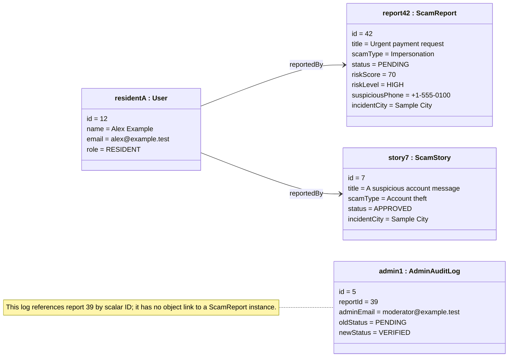

# ScamShield object diagram

A representative example snapshot. The names, addresses, IDs, and report text below are fictional; no real user data is shown.

The `ScamReport` and `ScamStory` links represent their `ManyToOne` relationship to `User`. The audit-log example deliberately has no association line to a report because the entity stores only `reportId`.
