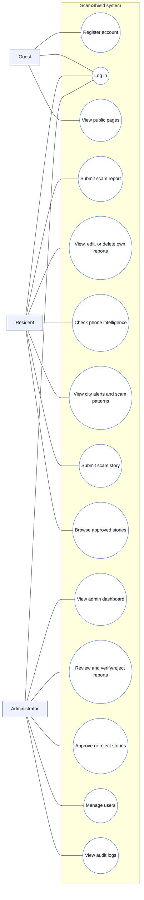

# ScamShield use-case diagram

Actors and capabilities shown at a high level. Ellipses represent use cases; the system boundary contains ScamShield features.

`/api/auth/register` and `/api/auth/login` are unauthenticated routes. The current configuration requires authentication for other API routes and the `ADMIN` role for `/api/admin/**`. "View public pages" refers to public web pages; the `/api/stories` API itself is protected by the current catch-all API rule.
